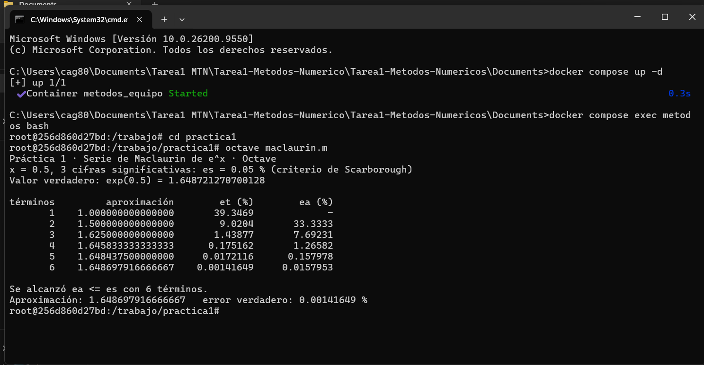
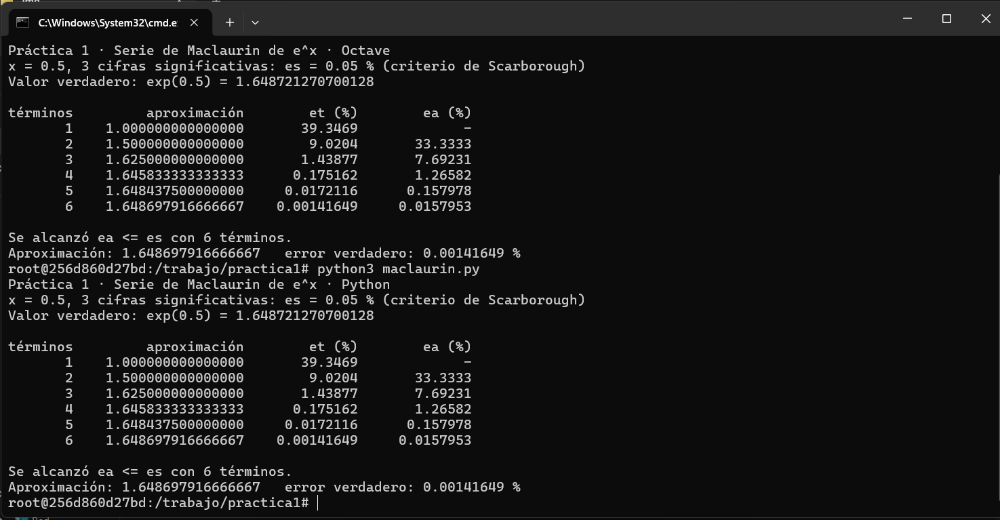
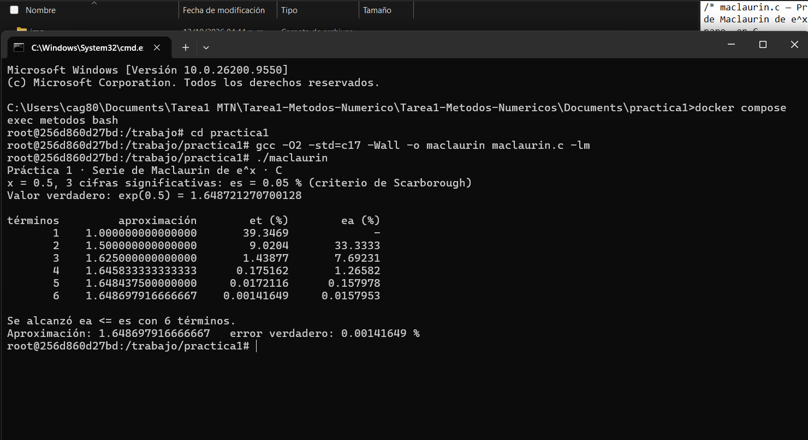

# Práctica 1 · La serie de Maclaurin y el criterio de paro

**UEA 1151039 · Métodos Numéricos en Ingeniería · Trimestre 26-O · UAM Azcapotzalco**
**Profesor:** M. en C. Gabriel Hurtado Avilés

| | |
|---|---|
| Equipo | Morado |
| Integrantes | Wendy Sismai Jiménez Mejía - 2233000794 - Ingeniería Ambiental <br> Jonathan Alexander Alvarado Alcocer - 2233040654 -  Ingeniería Mecánica |
| Repositorio de la Tarea 1 de | |
| Fecha | 12 de Octubre de 2026 |

## 1. Octave y Python




¿Coinciden con la lámina 25 de la unidad I?

## 2. Las dos líneas que completamos en `maclaurin.c`

```c
/* COMPLETAR 1 */
/* COMPLETAR 2 */
```



## 3. Más cifras significativas

| Cifras | εs (%) | Términos | Aproximación | Error verdadero (%) |
|---|---|---|---|---|
| 3 | 6  | 1.648698751666667 | 0.001414649 % |
| 6 | 9 | 1.64872165035962 | 3.43549e-07 % |
| 17 | 16 | 1.64872127700128 | 2.08554e-14 % | 

1. ¿Cuántos términos hacen falta en cada caso? Para 3 cifras se requirieron 6 términos, para 6 cifras se requirieron 9 términos, para 3 cifras se requirieron 16 términos para detener el algoritmo.
2. En cada fila de la tabla, ¿εa es mayor o menor que εt? ¿Por qué conviene detenerse con εa? En cada una de las filas observamos que el error relativo aproximado es mayor que el error verdadero ε>εt . Nos conviene detenernos utilizando εa como criterio de paro porque en la gran mayoria de problemas reales no conocemos el verdadero resultado de antemano. Al aplicar el criterio de Scaborough εa≤εs, evaluamos la diferencia entre la iteracion actual y la anterior, garantizando numericamente que la aproximacion obtenida cumple con el numero de cifras significativas requeridas sin necesidad de depender de un valor verdadero externo.
3. Con 17 cifras el programa termina. ¿Cuántas cifras del resultado son correctas en realidad?
   Relaciónenlo con 0.1 + 0.2 de la Tarea 1. Hay entre 15 y 16 cifras significativas correctas, en la memoria de la computadora, la representacion interna en binario no puede almacenar ciertos numeros decimales exactos, Esta limitacion introduce un error de redondeo minimo en numeros pequenos, pero que impide calcular resultados matematicos infinitos.  

## Uso de inteligencia artificial

Ninguno / Cuál y para qué.

## Referencias

